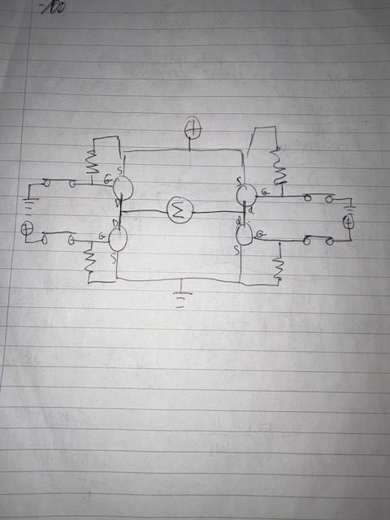
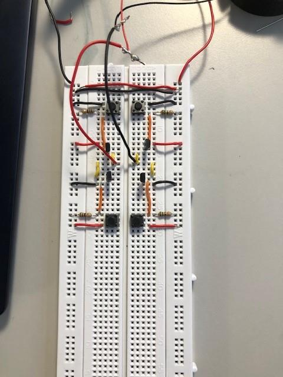
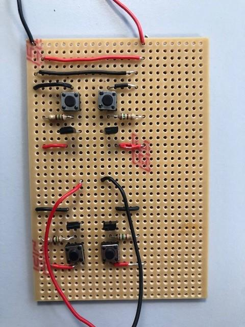

# H-Bridge DC Motor Control

Design, construction and testing of a MOSFET-based H-Bridge circuit for bidirectional DC motor control. The project explores transistor switching, pulse-width modulation (PWM), optical speed measurement and practical circuit implementation using breadboard and stripboard prototypes.

## Demo / Images

### H-Bridge Circuit Diagram

### H-Bridge Breadboard Prototype

### H-Bridge Stripboard Construction

Additional circuit diagrams, construction photographs and experimental measurements are available in [Project Documentation](docs/README.md).

## Hardware

- DC motor
- N-channel MOSFETs (ZVN630A)
- P-channel MOSFETs (ZVP2106A)
- Resistors and switches
- Breadboard and stripboard
- Benchtop DC power supply
- Digital multimeter
- Oscilloscope
- Optical motor-speed measurement setup
- Jumper wires and connecting leads

## How it works

An H-Bridge uses four switching devices to control the direction of current through a DC motor. Reversing the current direction reverses the motor's rotation.

The circuit uses N-channel and P-channel MOSFETs as electronic switches.

### MOSFET Switching

A MOSFET controls current between its drain and source terminals using a voltage applied to its gate.

- N-channel MOSFETs conduct when the gate-to-source voltage is sufficiently positive.
- P-channel MOSFETs conduct when the gate-to-source voltage is sufficiently negative.
- Appropriate switching combinations determine the direction of current through the motor.

### Bidirectional Motor Control

The full H-Bridge allows two operating directions:

1. Forward rotation: One diagonal pair of MOSFETs conducts.
2. Reverse rotation: The opposite diagonal pair conducts.
3. Stop: All switching devices are turned off.

MOSFET switching combinations that create a direct supply-to-ground path must be avoided to prevent short circuits and potential component damage.

### PWM Speed Control

Pulse-width modulation regulates the average power delivered to a motor by switching the supply on and off.

The PWM duty cycle represents the proportion of each switching period during which the signal is active.

Changing the duty cycle changes the average motor voltage and can be used to regulate motor speed.

## Circuit Development

### 1. Optical Motor-Speed Measurement

An optical sensing arrangement was used to investigate the relationship between supply voltage and motor speed.

Frequency measurements were converted into revolutions per minute (RPM).

### 2. Single-Direction Motor Control

A basic motor-driving circuit was constructed to demonstrate switching and motor operation in one direction.

The relationship between PWM, average voltage and motor speed was investigated using laboratory measurements.

### 3. Half-Bridge Construction

A split-supply circuit was constructed to investigate bidirectional motor control.

The experiment also demonstrated the importance of avoiding unsafe switching combinations.

### 4. Full H-Bridge Construction

The final circuit used N-channel and P-channel MOSFETs arranged to control current flow through the DC motor.

Breadboard and stripboard implementations were documented and evaluated.

## Build & test

1. Identify the MOSFET terminals and verify the component specifications.
2. Construct the initial single-direction motor circuit.
3. Connect the circuit to a current-limited DC power supply.
4. Investigate motor switching and PWM behaviour.
5. Construct the split-supply motor-control circuit.
6. Build the full MOSFET H-Bridge according to the circuit diagram.
7. Verify connections and check for unintended short circuits before applying power.
8. Test forward and reverse motor operation using the appropriate switching combinations.
9. Record motor behaviour and electrical measurements.

**Safety:** Switching combinations must be checked carefully. Incorrect MOSFET activation can cause supply short circuits, excessive current and component damage.

## Measurements and Results

### Optical Motor-Speed Measurements

The following measurements were recorded during the optical motor-speed sensing experiment.

| Supply Voltage (V) | Frequency (Hz) | Motor Speed (RPM) |
|---|---|---|
| 0.0 | 0.0 | 0 |
| 1.0 | 0.0 | 0 |
| 1.5 | 28.4 | 1704 |
| 2.0 | 38.1 | 2280 |
| 3.0 | 58.0 | 3480 |
| 4.0 | 79.5 | 4770 |
| 5.0 | 99.5 | 5970 |
| 6.0 | 117.0 | 7020 |

The measurements show motor speed increasing with applied voltage over the recorded operating range.

### H-Bridge Results

The laboratory project demonstrated bidirectional DC motor control using MOSFET switching.

The report records successful control of motor speed and direction, with minor heating observed in the MOSFETs.

## Results / notes

The project progressed from basic motor switching to a full H-Bridge implementation.

### Limitations

- Minor MOSFET heating was observed during operation.
- The manual switching arrangement requires care to avoid unsafe transistor combinations.
- Further testing would be useful to characterise efficiency and thermal performance.

### Future improvements

- Introduce microcontroller-based PWM and direction control.
- Add protection against simultaneous switching of incompatible MOSFET pairs.
- Improve thermal management.
- Incorporate motor-speed feedback for closed-loop control.

## What I learned

- How N-channel and P-channel MOSFETs operate as electronic switches.
- How H-Bridge circuits reverse the direction of DC motor rotation.
- How PWM can be used to control motor speed.
- How to construct and test motor-control circuits on breadboard and stripboard.
- How to measure motor speed using optical sensing.
- How to interpret oscilloscope and motor-speed measurements.
- Why switching safety and MOSFET power dissipation matter in motor-driver circuits.

## Credits

Developed as part of an Electrical and Electronic Engineering laboratory project.

**Hardware:**
- DC motor
- ZVN630A N-channel MOSFETs
- ZVP2106A P-channel MOSFETs
- Laboratory power supply and measurement equipment

## License

This project is licensed under the MIT License. See [LICENSE](LICENSE) for details.
