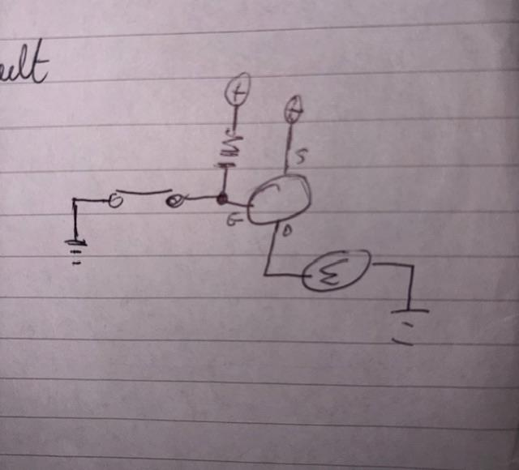
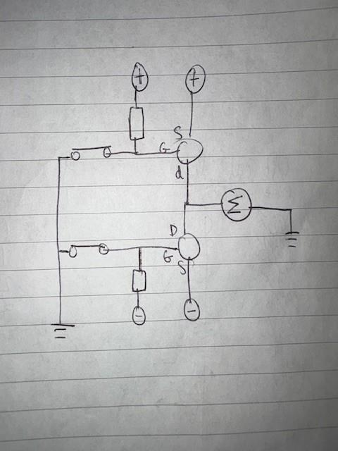
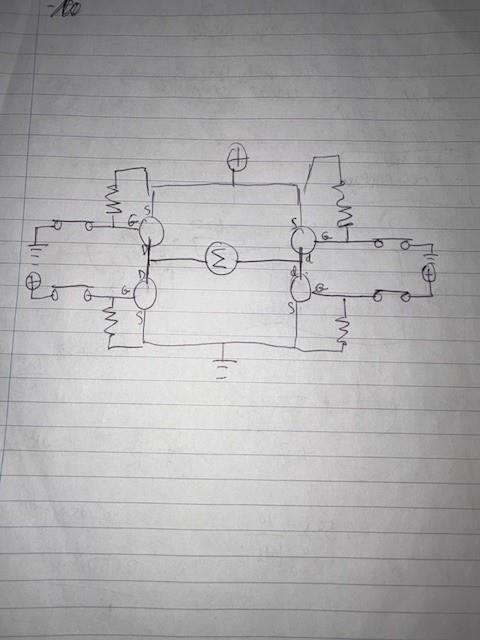
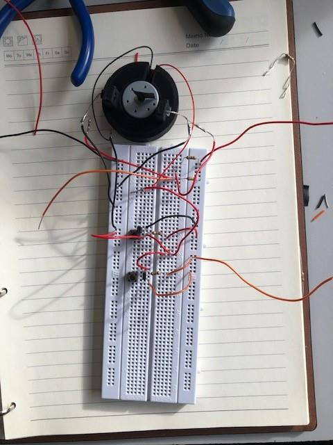
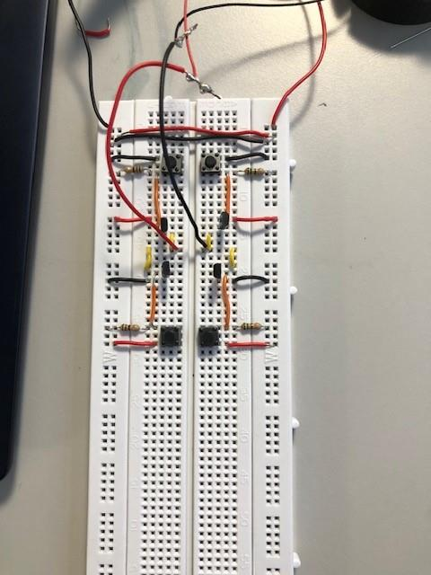
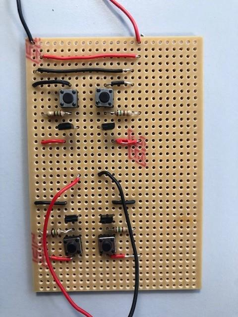
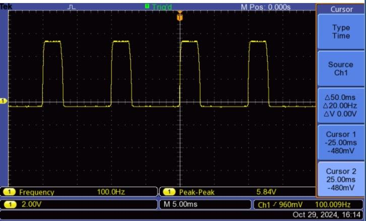
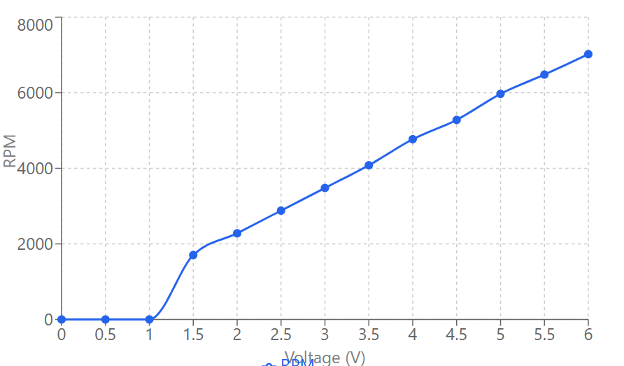

# H-Bridge Project Documentation

This folder contains the original circuit diagrams, construction photographs and experimental measurements from the H-Bridge DC Motor Control laboratory project.

## Circuit Diagrams

### Single-Direction Motor Control Circuit

Initial motor-control circuit used to investigate motor switching.

### Split-Supply Motor Control Circuit

Circuit developed to investigate bidirectional motor operation.

### Full H-Bridge Circuit

Final MOSFET H-Bridge circuit for reversing the direction of current through the DC motor.

## Construction Photographs

### Split-Supply Breadboard Prototype

Physical construction of the split-supply motor-control circuit.

### H-Bridge Breadboard Prototype

Breadboard implementation of the H-Bridge motor-control circuit.

### H-Bridge Stripboard Construction

Stripboard implementation demonstrating practical circuit assembly.

## Experimental Measurements

### PWM Oscilloscope Measurement

Oscilloscope measurements used during the investigation of motor speed control.

### Motor-Speed Measurements

Experimental results showing the relationship between supply voltage and motor speed.

---

All images are from the original Electrical and Electronic Engineering laboratory logbook.
